```mermaid
flowchart LR
    A([Developer]) --> B[Git]
    B --> C[GitHub]
    C --> D[Jenkins]
    D --> E[Maven Build]
    E --> F[SonarQube]
    F --> G[Nexus Repository]
    G --> H[Apache Tomcat]
    H --> I([AWS EC2])

    classDef src fill:#0b1220,stroke:#00C6FF,color:#e6f6ff,stroke-width:2px;
    classDef gate fill:#12306B,stroke:#38BDF8,color:#ffffff,stroke-width:2px;
    classDef run fill:#020617,stroke:#38BDF8,color:#e6f6ff,stroke-width:2px;

    class A,B,C src;
    class D,E,F,G gate;
    class H,I run;
```

# 👋 Hi, I'm Madhusudan Kundrupe

<div align="center">


<br/>


<br/><br/>

<a href="https://www.linkedin.com/in/madhusudan-kundrupe-3723902a3/">

</a>

<a href="mailto:madhusudankundrupe3114@gmail.com">

</a>

<a href="https://github.com/madhusudankundrupe3114-cell">

</a>

</div>


<div align="center">


</div>

<table>
<tr>
<td width="58%" valign="top">

### Hello, I'm Madhusudan 👋

I'm an Electronics and Telecommunication Engineering graduate from Maharashtra, India, interested in **DevOps, Cloud Computing, and CI/CD automation**.

I'm building my technical skills in software delivery, Linux, Git, Jenkins, and cloud infrastructure while working on practical projects.

My goal is to become a skilled DevOps Engineer and contribute to reliable, automated software deployment workflows.

- 🎓 BE Electronics & Telecommunication
- 💻 DevOps and Cloud Computing
- 🔄 CI/CD pipeline automation
- ☁️ AWS cloud infrastructure
- 🐧 Linux and Bash
- 📦 Docker and containerization
- 🛠️ Jenkins, Maven, Git
- 🚀 Interested in DevOps and Cloud opportunities

</td>
<td width="42%" valign="top">

```bash
$ whoami
madhusudan-kundrupe

$ cat profile.yml

role: DevOps Engineer
education: BE ENTC
graduation: 2026

focus:
  - DevOps
  - Cloud Computing
  - CI/CD

technologies:
  - Jenkins
  - Maven
  - Git
  - AWS
  - Linux
  - Docker

$ echo $STATUS
learning_and_building
```

</td>
</tr>
</table>

> **Career Goal:** To build expertise in DevOps, cloud infrastructure, automation, and continuous integration and deployment.

Currently focusing on improving my practical skills through projects and hands-on learning.


<div align="center">


</div>

<div align="center">



</div>


<div align="center">


</div>

<div align="center">


<br/><br/>

| Domain | Technologies |
|:---:|:---|
| ☁️ **Cloud** | AWS EC2 |
| 🐧 **Operating System** | Linux |
| 🔄 **CI/CD** | Jenkins |
| 🏗️ **Build Automation** | Maven |
| 🛡️ **Code Quality** | SonarQube |
| 📦 **Artifact Management** | Nexus Repository |
| 🌐 **Application Server** | Apache Tomcat |
| 🐳 **Containerization** | Docker |
| 🔧 **Version Control** | Git, GitHub |
| 💻 **Programming** | Java, SQL |
| 🌐 **Web Technologies** | HTML, CSS, JavaScript |
| 🛠️ **Scripting** | Bash |

</div>


<div align="center">


</div>

<table>
<tr>
<td width="50%" valign="top">

### 🚀 Jenkins CI/CD Pipeline

Automated software build and deployment pipeline using DevOps tools.

**Technologies**

- Jenkins
- Maven
- SonarQube
- Nexus Repository
- Apache Tomcat
- Git
- Groovy
- AWS EC2

**Highlights**

- Created a Jenkins pipeline using Groovy.
- Automated Maven build and testing.
- Integrated SonarQube code quality analysis.
- Managed build artifacts using Nexus.
- Automated application deployment to Tomcat.
- Used AWS EC2 for deployment infrastructure.

</td>
<td width="50%" valign="top">

### 📡 Communication Device for Deafblind

Engineering project focused on communication assistance for deafblind individuals.

**Technologies**

- Python
- Flask
- Whisper
- pyttsx3
- Frontend technologies

**Highlights**

- Worked on PCB-related implementation.
- Contributed to frontend development.
- Explored speech recognition using Whisper.
- Used text-to-speech functionality.
- Worked on communication accessibility.

</td>
</tr>

<tr>
<td width="50%" valign="top">

### 🎓 Student Management System

Java-based student management application.

**Technologies**

- Java
- Hibernate
- JSP
- MySQL
- Apache Tomcat

**Highlights**

- Implemented CRUD operations.
- Managed student records.
- Integrated Hibernate with MySQL.
- Created JSP-based user interface.
- Used Apache Tomcat for application execution.

</td>
<td width="50%" valign="top">

### ☁️ DevOps Learning & Practice

Hands-on learning focused on cloud infrastructure and software delivery.

**Focus Areas**

- Linux commands
- Git and GitHub
- Jenkins pipeline development
- Maven build automation
- AWS EC2
- Docker fundamentals

</td>
</tr>
</table>

<div align="center">

<a href="https://github.com/madhusudankundrupe3114-cell?tab=repositories">

</a>

</div>


<div align="center">


</div>

<div align="center">

<a href="https://github.com/ryo-ma/github-profile-trophy">

</a>

</div>


<div align="center">


</div>

<div align="center">

<a href="https://github.com/madhusudankundrupe3114-cell">

</a>

<a href="https://github.com/madhusudankundrupe3114-cell">

</a>

<br/><br/>


</div>


<div align="center">


</div>

<div align="center">


</div>


<div align="center">


</div>

<div align="center">


</div>

- Improving Linux and shell scripting skills.
- Practicing Jenkins pipeline automation.
- Learning cloud infrastructure with AWS.
- Exploring Docker and container deployment.
- Strengthening Git and GitHub workflows.
- Building practical DevOps projects.


<div align="center">


</div>

<div align="center">

**Interested in DevOps, cloud infrastructure, automation, and software delivery? Let's connect.**

<br/>

<a href="https://www.linkedin.com/in/madhusudan-kundrupe-3723902a3/">

</a>

<a href="mailto:madhusudankundrupe3114@gmail.com">

</a>

<a href="https://github.com/madhusudankundrupe3114-cell">

</a>

<br/><br/>


</div>
